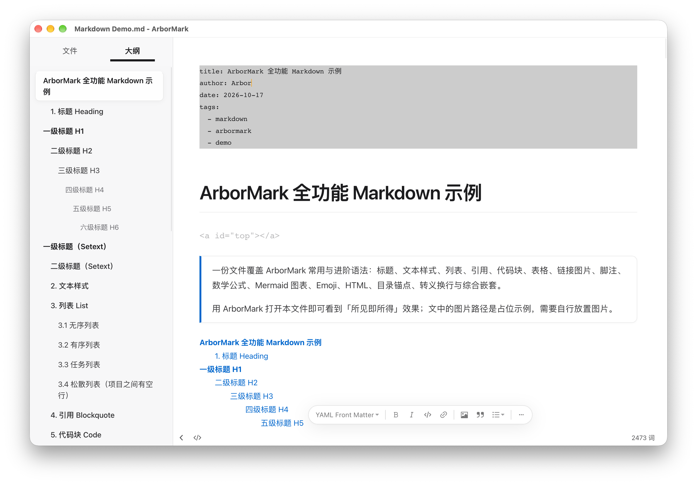

<p align="center">
  
</p>

<h1 align="center">ArborMark</h1>

<p align="center">Un editor Markdown WYSIWYG local para el escritorio</p>

<p align="center">
  <a href="README.md">English</a> ·
  <a href="README.zh-CN.md">简体中文</a> ·
  <a href="README.zh-TW.md">繁體中文</a> ·
  <a href="README.ja.md">日本語</a> ·
  <a href="README.ko.md">한국어</a> ·
  <a href="README.de.md">Deutsch</a> ·
  <a href="README.fr.md">Français</a> ·
  <a href="README.es.md">Español</a>
</p>

<p align="center">
  <a href="LICENSE"></a>
  
  
  
</p>

<p align="center">
  
</p>

***

## Introducción

ArborMark (nombre chino: 简筑) es un editor Markdown independiente para el escritorio, desarrollado con **Tauri 2 + Rust** en el backend y **React + Milkdown (ProseMirror)** en el frontend, con **CodeMirror 6** para el modo de código fuente en texto plano.

Combina la sencillez de Markdown con la inmediatez de un editor enriquecido: el contenido se renderiza en tiempo real mientras escribe, y con un atajo (⌘/Ctrl + /) pasa al modo código fuente. Los documentos se guardan localmente como archivos estándar `.md` sin dependencias de la nube ni cuentas obligatorias.

* Repositorio: <https://github.com/Arbor4/ArborMark>
* Notificar problemas: <https://github.com/Arbor4/ArborMark/issues>
* Descargas: <https://github.com/Arbor4/ArborMark/releases>

---

## ¿Por qué elegir ArborMark?

| Criterio | ArborMark | Editores Markdown basados en Electron | Su ventaja |
| :--- | :--- | :--- | :--- |
| **Tamaño de descarga** | **~15 MB** | 120 MB ~ 180 MB+ | 🚀 **90% más ligero**, descarga e instalación instantáneas |
| **Consumo de memoria** | **~50 MB - 80 MB** | 300 MB ~ 600 MB+ | 🍃 Ultraligero, múltiples ventanas sin ralentizaciones |
| **Inicio en frío** | **< 300 ms** instantáneo | 2 a 4 segundos | ⚡ Listo en milisegundos para registrar sus ideas |
| **Local-First** | **100% sin conexión y privado** | Obligación de cuenta o sincronización en la nube | 🔒 Soberanía absoluta de sus notas y documentos |
| **Motor dual** | **Milkdown + CodeMirror 6** | Webview única o vista dividida | 🎨 Lo mejor del formato WYSIWYG y la edición de código |
| **Multiventana** | **Nativo e independiente (⌘⇧N)** | Pestañas lentas o memoria duplicada | 🪟 Trabaje en paralelo con varios documentos |

---

## Características

| Característica | Descripción |
| :--- | :--- |
| WYSIWYG en tiempo real | Renderizado mientras escribe; edición directa de encabezados, tablas, fórmulas y diagramas |
| Modo fuente dual | Editor de texto plano CodeMirror 6 con numeración fija, plegado de código y resaltado (⌘/Ctrl + /) |
| Archivos y navegación | Árbol de carpetas, lista plana, esquema de títulos, apertura rápida (⌘P) y búsqueda global (⌘⇧F) |
| Sistema de preferencias | Paneles dedicados (Archivos, Apariencia, Editor, Markdown, Imágenes, Exportación y General) con saltos LF/CRLF |
| Ergonomía de edición | Copiar/cortar línea completa sin selección previa (⌘C / ⌘X), zoom con Ctrl/⌘ + rueda y cierre de símbolos |
| Tablas y fórmulas | Barra flotante, inserción y borrado de filas/columnas, redimensionamiento; edición KaTeX in situ con autonumeración |
| Diagramas | Diagramas Mermaid, Flowchart.js y Sequence con escala automática y renderizado diferido |
| Imágenes y PDF | Guardado local por arrastrar y pegar, rutas relativas preferidas, visor ampliado y previsualización de PDF |
| Soporte multiventana | Flujo de trabajo nativo con múltiples ventanas independientes (⌘⇧N) |
| Importación y exportación | Exportación a PDF y HTML de alta fidelidad; conversiones Word / EPUB / LaTeX con Pandoc |
| Temas visuales | Varios temas integrados elegantes (incluido **Liquid Glass**) y carga en vivo de temas CSS/JSON |
| Internacionalización global | Español, Inglés, Chino (simplificado/tradicional), Japonés, Alemán, Francés, etc. (16+ idiomas) |
| Guardado seguro | Autoguardado al cambiar de archivo, prevención de rebote al escribir, seguimiento de cambios y seguridad ante fallos |
| Línea de comandos y arrastre | Abra archivos o carpetas rápidamente desde la terminal o arrastrándolos a la ventana |

## Descarga e instalación

Descargue el instalador para su sistema desde [Releases](https://github.com/Arbor4/ArborMark/releases):

* macOS: `.dmg` / `.zip`
* Windows: instalador NSIS / ejecutable portable `.zip`
* Linux: `.AppImage` / `.deb`

En macOS, si Gatekeeper bloquea el primer inicio, autorice la aplicación en **Ajustes del Sistema → Privacidad y seguridad**.

## Desarrollo

### Requisitos

* Node.js **20+** y npm 10+
* Cadena de herramientas Rust **stable** (`rustup`, edición 2021)
* macOS, Windows o Linux (Linux requiere paquetes dev de WebKitGTK 4.1 / GTK 3)

### Ejecución local

```bash
git clone https://github.com/Arbor4/ArborMark.git
cd ArborMark
npm install                 # raíz: Tauri CLI
npm install --prefix src/web

npm run dev                 # tauri dev: Vite dev server + shell nativo
# o solo frontend en el navegador:
npm run web:dev
```

### Verificación y pruebas

```bash
npm run web:build           # comprobación de tipos (tsc --noEmit) + build de producción Vite
npm --prefix src/web run typecheck
(cd src-tauri && cargo test)   # pruebas unitarias de Rust
```

### Compilación y empaquetado

```bash
npm run dist:mac       # macOS app + dmg
npm run dist:win       # Windows nsis (con versión offline de WebView2)
npm run dist:linux     # Linux deb + AppImage
```

## Licencia

ArborMark se distribuye bajo la licencia **GNU General Public License v3.0 o posterior (GPL-3.0-or-later)**.
Consulte el archivo [LICENSE](LICENSE) para ver el texto completo.

***

Copyright © 2026 Arbor · ArborMark contributors
