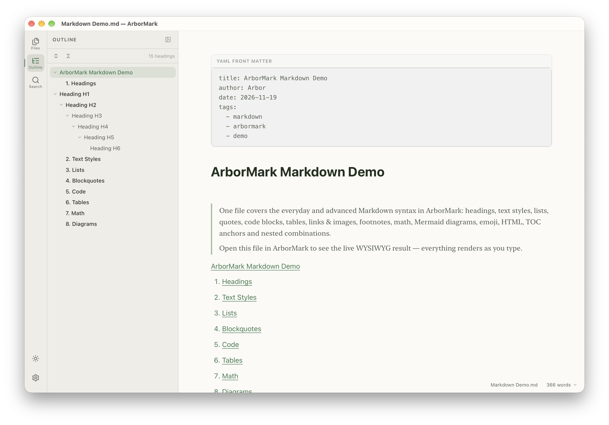
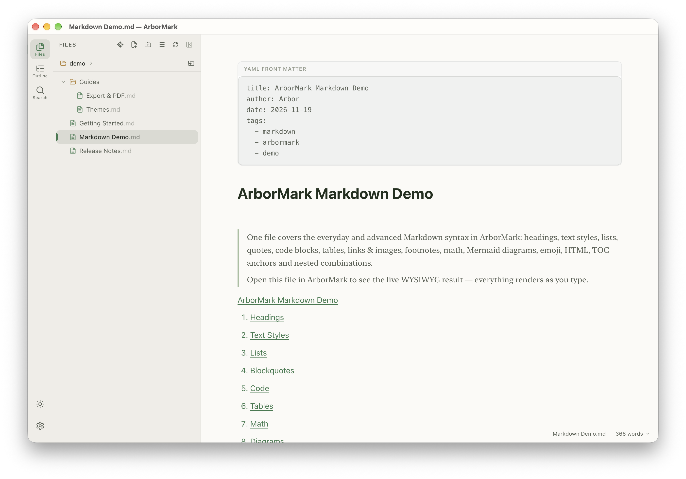
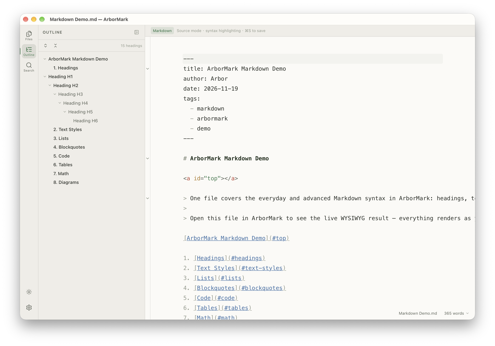
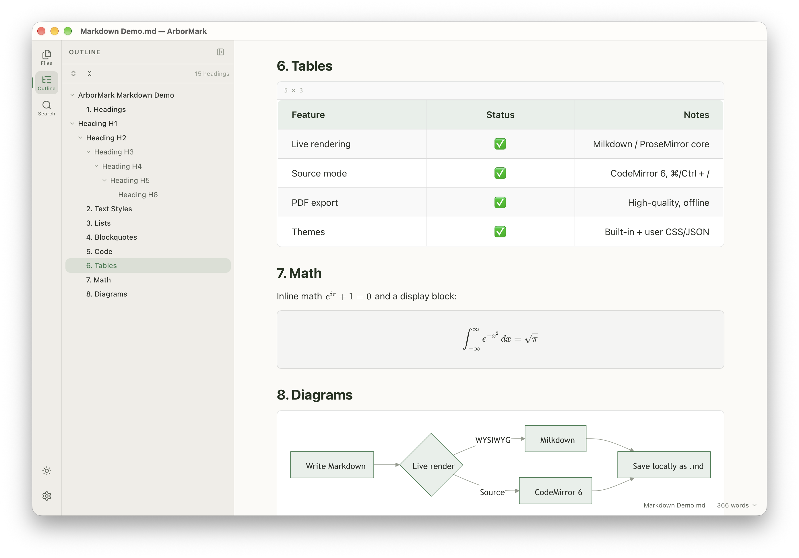
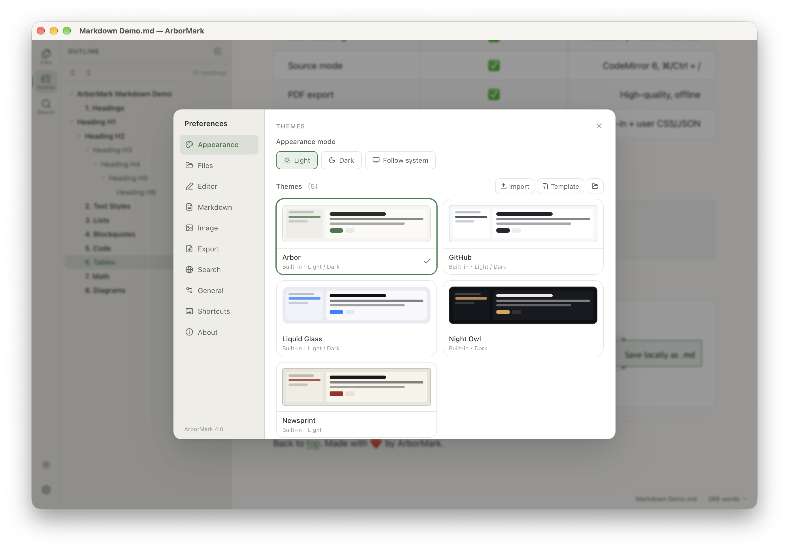
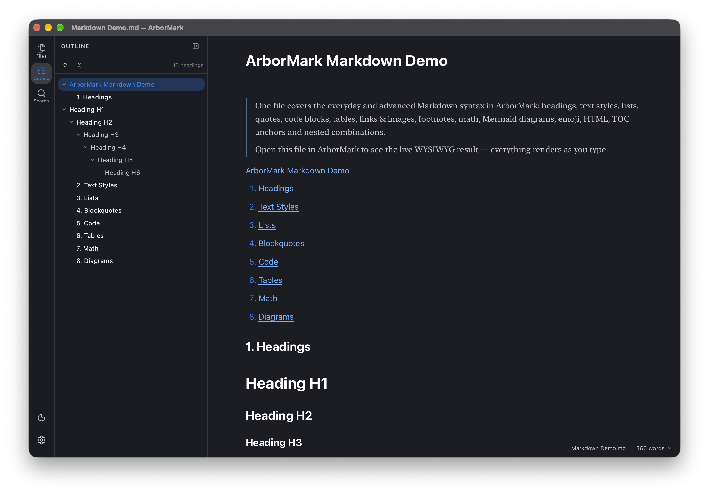

<p align="center">
  
</p>

<h1 align="center">ArborMark</h1>

<p align="center">A local-first, WYSIWYG Markdown editor for the desktop</p>

<p align="center">
  <a href="README.md">English</a> ·
  <a href="README.zh-CN.md">简体中文</a> ·
  <a href="README.zh-TW.md">繁體中文</a> ·
  <a href="README.ja.md">日本語</a> ·
  <a href="README.ko.md">한국어</a> ·
  <a href="README.de.md">Deutsch</a> ·
  <a href="README.fr.md">Français</a> ·
  <a href="README.es.md">Español</a>
</p>

<p align="center">
  <a href="LICENSE"></a>
  
  
  
</p>

<p align="center">
  
</p>

***

## Introduction

ArborMark (Chinese name: 简筑) is a modern, ultra-lightweight, high-performance WYSIWYG Markdown editor for the desktop. Built with **Tauri 2 + Rust** on the native foundation, **React 19 + Milkdown (ProseMirror)** for seamless live rich-text rendering, and **CodeMirror 6** for an industrial-grade plain-text source mode.

It bridges the gap between the clean simplicity of Markdown and the visual feedback of a rich-text document processor: render as you type, and switch effortlessly to pure code with a single shortcut (`⌘/Ctrl + /`). All files are saved locally as standard `.md` plain text — **zero account requirement, zero tracking, 100% privacy-first**.

- Repository: <https://github.com/Arbor4/ArborMark>
- Issue Tracker: <https://github.com/Arbor4/ArborMark/issues>
- Releases: <https://github.com/Arbor4/ArborMark/releases>

---

## Why ArborMark?

| Dimension / Metric | ArborMark | Traditional Electron Markdown Editors | Benefit |
| :--- | :--- | :--- | :--- |
| **Installer Size** | **~15 MB** | 120 MB ~ 180 MB+ | 🚀 **90% smaller**, lightning-fast downloads, minimal disk usage |
| **RAM Footprint** | **~50 MB - 80 MB** | 300 MB ~ 600 MB+ | 🍃 Featherlight background overhead, open multiple windows without lag |
| **Cold Startup** | **< 300 ms** instant launch | 2s ~ 4s loading splash | ⚡ Opens immediately to capture your fleeting thoughts |
| **Local-First** | **100% Offline & Private** | Cloud sync lock-in / forced login | 🔒 Complete data sovereignty; no data ever leaves your computer |
| **Dual Engine** | **Milkdown (ProseMirror) + CodeMirror 6** | Monolithic Webview or split-screen previews | 🎨 Best-in-class WYSIWYG editing paired with professional source mode |
| **Multi-Window** | **Native Multi-Window (⌘⇧N)** | Slow tabs or doubled RAM per instance | 🪟 Independent window viewports for parallel side-by-side editing |

---

## Key Highlights

### 1. Immersive Writing & Polished Ergonomics
- **Dual-Mode Fluid Switch**: Seamlessly transition between live rendered state and pure source mode with `⌘/` (or `Ctrl+/`), keeping your cursor line perfectly in place.
- **Typewriter Mode**: The caret stays centered vertically on screen, sparing your eyes from jumping up and down.
- **Focus Mode**: Dims surrounding text to highlight only the paragraph you are actively writing.
- **Whole-Line Copy & Cut**: When nothing is selected, pressing `⌘C` / `Ctrl+C` copies the full line, and `⌘X` / `Ctrl+X` cuts and removes the line (matching the beloved Typora & VS Code convention).
- **Ctrl/⌘ + Wheel Zoom**: Hold Ctrl or ⌘ and scroll the mouse wheel to smoothly adjust the editor font size in 1px increments (12px ~ 28px).
- **Smart Auto-Pairing**: Brackets, quotes, and Markdown delimiters (`*`, `~`, `$`) close automatically.

### 2. High-Productivity Tables & Math
- **Interactive Table Toolbar**: Floating context menu provides one-click row/column insertion, deletion, clearing, and table removal.
- **Drag-to-Resize & Reorder**: Drag column borders to set custom column widths; drag rows or columns to reorder.
- **KaTeX In-Place LaTeX Math**: Real-time rendering for inline `$math$` and block `$$math$$`; click any equation to edit the TeX code directly, press `Esc` to re-render; optional equation numbering.

### 3. Native Diagrams & Local Asset Pipeline
- **Mermaid & Popular Diagram Engines**: Built-in Mermaid support for flowcharts, sequence diagrams, class diagrams, state diagrams, and Gantt charts with automatic viewBox aspect-ratio preservation.
- **Automatic Asset Disk Storage**: Drag or paste images directly into the document with configurable storage destinations (`./`, `./assets`, `./${filename}.assets`, or custom paths); automatic URL encoding and relative path preferences.
- **In-App Image Lightbox & PDF Viewer**: Click any image to launch an image lightbox with smooth wheel zoom and double-click fit; native preview for embedded PDFs.

### 4. Comprehensive Typora-Aligned Preferences
- **7 Dedicated Settings Panels**: Files, Appearance, Editor, Markdown, Image, Export, and General.
- **Line Ending Standards (EOL)**: Choose between `LF (Unix/macOS)` and `CRLF (Windows)` line breaks; automatically respected on save.
- **Default File Extensions**: Automatically appends `.md` or `.markdown` when creating new files without an extension.
- **Safe Persistence & History**: Auto-save on switch, debounced auto-save on typing pause, one-click recent files history clearance, and one-click factory reset.

### 5. Effortless Navigation & Flexible Export
- **Heading Outline & Search**: Collapsible multi-level outline with ScrollSpy heading tracking; instant quick-open modal (`⌘P`) and cross-file regex find & replace (`⌘⇧F`).
- **Open Theme Ecosystem**: Built-in themes including **Liquid Glass**, Lucid Light, and more; fully decoupled via CSS tokens with template export and custom JSON/CSS importing.
- **Multi-Format Export**: One-click export to print-ready PDF, styled standalone HTML, and clean semantic HTML; supports Pandoc CLI integration for Word (`.docx`), EPUB, and LaTeX conversions.
- **Global Localization**: 16+ languages (Simplified/Traditional Chinese, English, Japanese, Korean, German, French, Spanish, etc.) synchronized with native OS menu bars.

---

## Features Matrix

| Module | Capabilities |
| :--- | :--- |
| **Live WYSIWYG** | Render-as-you-type; in-place editing for headings, lists, quotes, tables, code blocks, math, and diagrams |
| **Source Mode** | CodeMirror 6 plain-text editor, sticky solid line number gutters, code folding, and syntax highlighting |
| **Lightweight** | ~15MB installer size, ~60MB idle memory, <300ms cold startup, virtualized viewport for long documents |
| **Ergonomics** | Typewriter mode, focus mode, whole-line copy/cut without selection, Ctrl/⌘ wheel zoom, smart pair matching |
| **Tables** | Floating toolbar, in-place row/col insertion, column drag-resizing, and row/column reordering |
| **Math & Diagrams** | In-place KaTeX math editing with auto-numbering; Mermaid flow/sequence diagrams with auto aspect-ratio |
| **Images & Media** | Local drag-and-paste file saving, relative path rules, in-app lightbox viewer, and PDF preview |
| **Preferences** | Typora parity: Files, Appearance, Editor, Markdown, Images, Export, General; LF/CRLF and factory reset |
| **Multi-Window** | Native independent multi-window workflow (⌘⇧N) for parallel document multitasking |
| **Navigation** | Folder tree, flat list, collapsible outline with ScrollSpy, quick open (⌘P), and global regex search (⌘⇧F) |
| **Import & Export** | High-fidelity PDF export, standalone HTML, clean HTML; Pandoc-based Word (.docx), EPUB, and LaTeX |
| **Themes** | Curated built-in themes (incl. **Liquid Glass**) + hot-reloadable user CSS/JSON themes |
| **Global i18n** | 16+ languages with automatic system detection and native operating system menu synchronization |
| **Data Safety** | Auto-save on switch, typing debounce writes, dirty tracking, and crash-safe local file storage |

## Screenshots

All screenshots below are captured from the English interface of ArborMark 4.0 on macOS.

| Files & workspace | CodeMirror 6 source mode |
| :---: | :---: |
|  |  |
| **Tables, KaTeX math & Mermaid diagrams** | **Preferences — appearance & themes** |
|  |  |

<p align="center">
  
  <br>
  <em>Dark mode — every built-in theme ships light and dark variants.</em>
</p>

## Download and install

Get the installer for your platform from [Releases](https://github.com/Arbor4/ArborMark/releases):

- macOS: `.dmg` / `.app`
- Windows: NSIS installer (standard and offline WebView2 editions)
- Linux: `.AppImage` / `.deb`

On macOS, if Gatekeeper blocks the first launch, allow the app under **System Settings → Privacy & Security**.

## Development

### Requirements

- Node.js **20+** and npm 10+
- Rust toolchain **stable** (`rustup`, edition 2021)
- macOS, Windows, or Linux (Linux needs the WebKitGTK 4.1 / GTK 3 dev packages)

### Run locally

```bash
git clone https://github.com/Arbor4/ArborMark.git
cd ArborMark
npm install                 # root: Tauri CLI
npm install --prefix src/web

npm run dev                 # tauri dev: starts the Vite dev server + native shell
# or frontend-only in a browser:
npm run web:dev
```

### Check & test

```bash
npm run web:build           # typecheck (tsc --noEmit) + Vite production build
npm --prefix src/web run typecheck
(cd src-tauri && cargo test)   # Rust unit tests
```

### Packaging

```bash
npm run dist:mac       # macOS app + dmg
npm run dist:win       # Windows nsis (+ offline WebView2 edition)
npm run dist:linux     # Linux deb + AppImage
```

## Project structure

```text
ArborMark/
├── src/
│   └── web/                 # React frontend (Vite)
│       └── src/
│           ├── components/  # Editor (Milkdown/CodeMirror), files, outline, settings, lightbox
│           ├── stores/      # Zustand stores: workspace, ui, find, lightbox, search
│           ├── bridge/      # Typed IPC / fs / i18n bridges to the Rust backend
│           ├── theme/       # Theme contract, built-in presets, registry
│           └── styles/      # Design tokens + component styles
├── src-tauri/               # Rust backend (Tauri 2)
│   └── src/
│       ├── ipc/             # IPC domains: fs, images, export, shell, settings, ...
│       ├── menu.rs          # Native menu (macOS/Windows/Linux) + parity sync
│       ├── protocol.rs      # arbormark:// custom protocol (local file serving)
│       └── lib.rs           # App setup, window & drag-drop wiring
├── resources/               # App icons and installer assets
├── tools/                   # Icon generation helpers
└── docs/                    # Architecture notes and screenshots
```

See [docs/ARCHITECTURE.md](docs/ARCHITECTURE.md) for a closer look at the module layout.

## Design notes

- **Local-first**: documents, images, themes, and settings live on your machine by default.
- **Plain text**: everything is saved as standard Markdown and can be opened elsewhere.
- **Themeable**: themes are token sets (CSS/JSON); drop one into the user theme folder and it is discovered automatically.
- **Safe by default**: the webview talks to Rust through a narrow IPC surface; local files are served via a scoped custom protocol.
- **Performance**: heavy node views (diagrams) render lazily near the viewport; long images scroll in place.

The built-in full-feature example is available from **Help → Markdown Demo** inside the app. The source file is [markdown-full-demo.md](src/web/src/bridge/demo/markdown-full-demo.md).

## Contributing

Issues and pull requests are welcome.

1. Fork the repository and create a branch: `feat/your-feature` or `fix/your-fix`.
2. Run the relevant checks before submitting (`npm run web:build`, `cargo test`).
3. Use semantic commit messages, for example:
   - `feat(editor): support an additional code-block language`
   - `fix(export): restore missing images in PDF export`
4. Describe the change, how it was tested, and include screenshots for UI changes.

By submitting a contribution, you agree to license it under the project's open-source license.

## License

ArborMark is released under the **GNU General Public License v3.0 or later (GPL-3.0-or-later)**.

You are free to use, copy, modify, and distribute the project, including commercially. The copyleft requirement applies: **if you distribute a derivative work, it must also be released under GPL-3.0-or-later with complete source code**. The software is provided without warranty.

See [LICENSE](LICENSE) for the full text.

## Third-party components

ArborMark builds on several excellent open-source projects, including:

- [Tauri](https://tauri.app/) and [Rust](https://www.rust-lang.org/) (MIT / Apache-2.0)
- [React](https://react.dev/) (MIT)
- [Milkdown](https://milkdown.dev/) / [ProseMirror](https://prosemirror.net/) (MIT)
- [CodeMirror](https://codemirror.net/) (MIT)
- [KaTeX](https://katex.org/) (MIT)
- [Mermaid](https://mermaid.js.org/) (MIT)
- [highlight.js](https://highlightjs.org/) (BSD-3-Clause)
- [DOMPurify](https://github.com/cure53/DOMPurify) (Apache-2.0 / MPL-2.0)

Full copyright and license information is available in each dependency's LICENSE file.

## Disclaimer

ArborMark is an independent open-source project and is not affiliated with, endorsed by, or sponsored by any commercial Markdown editor. The project name, icons, and interface assets are original or used with permission; third-party components remain the property of their respective authors.

If you believe content in this project infringes your rights, please contact us via [Issues](https://github.com/Arbor4/ArborMark/issues).

***

Copyright © 2026 Arbor · ArborMark contributors
