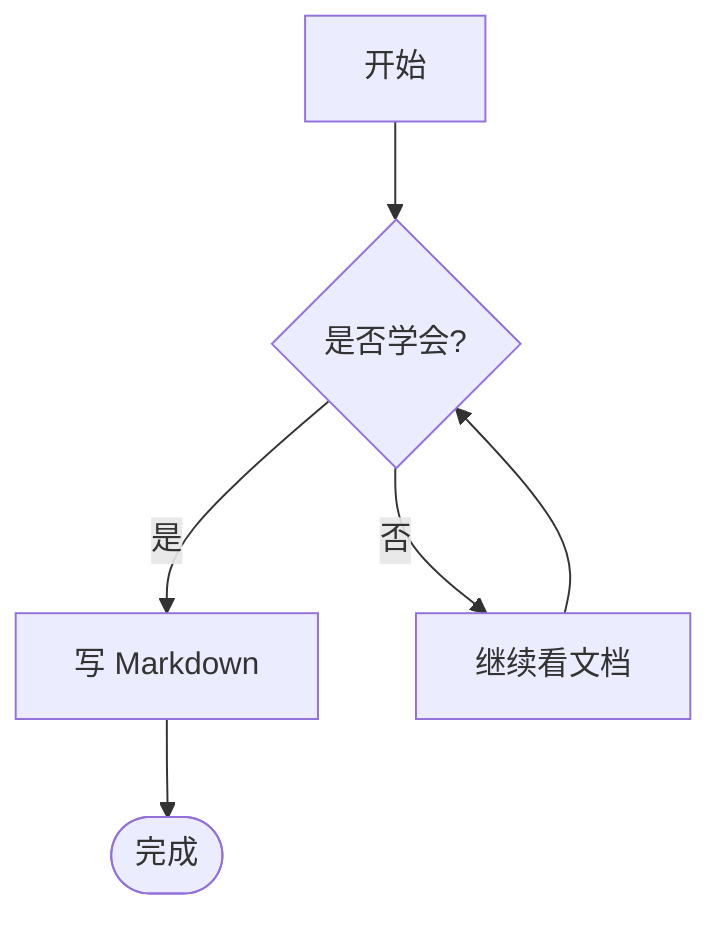
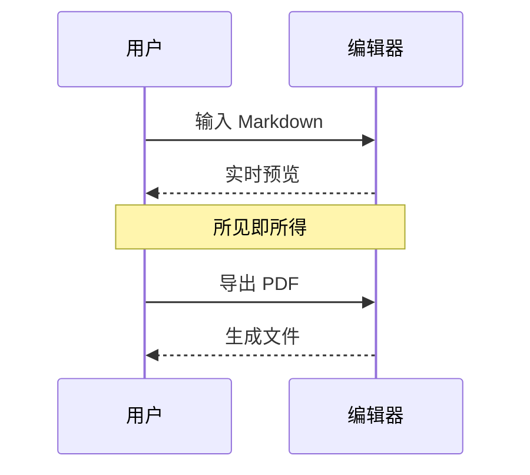
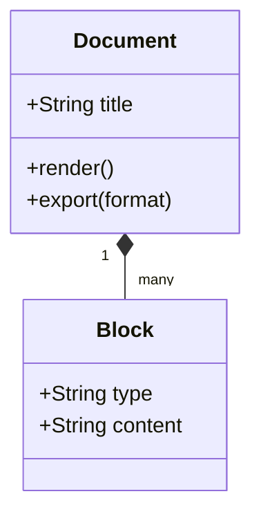
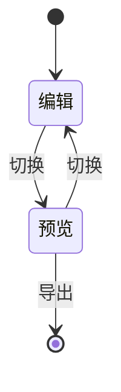
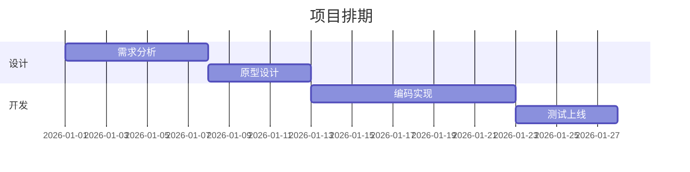
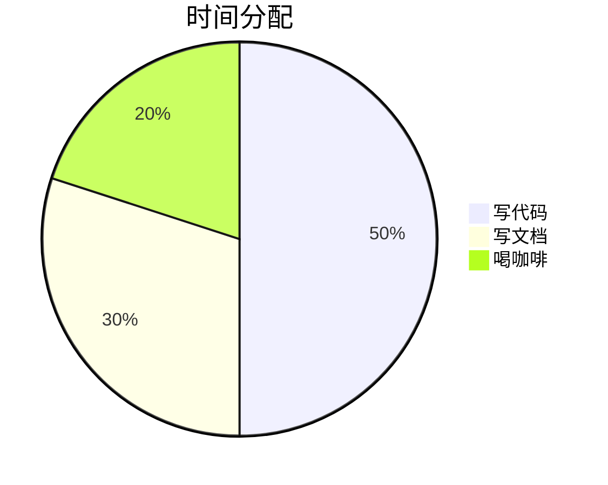

# Markdown 全功能示例

<a id="top"></a>

> 一份文件覆盖常用与进阶 Markdown 语法：标题、文本样式、列表、引用、代码块、表格、链接图片、脚注、数学公式、Mermaid 图表、Emoji、HTML、目录锚点、转义换行与综合嵌套。
>
> 用 ArborMark 打开本文件即可看到「所见即所得」效果；文中的图片路径是占位示例，需要自行放置图片。

[TOC]

---

## 1. 标题 Heading

支持 ATX 与 Setext 两种标题写法。

# 一级标题 H1

## 二级标题 H2

### 三级标题 H3

#### 四级标题 H4

##### 五级标题 H5

###### 六级标题 H6

Setext 风格（仅一级、二级）：

一级标题（Setext）
==================

二级标题（Setext）
------------------

## 2. 文本样式

普通文本、**粗体**、*斜体*、***粗斜体***、~~删除线~~、==高亮==、`行内代码`、<u>下划线</u>、^上标^、~下标~。

可以组合使用：**粗体里带 ==高亮== 和 `代码`**，*斜体里带 ~~删除线~~*。

键盘按键：<kbd>Ctrl</kbd> + <kbd>Shift</kbd> + <kbd>K</kbd>。

HTML 强调：<mark>mark 标记</mark>、<strong>strong</strong>、<em>em</em>、<sup>2</sup>、H<sub>2</sub>O。

行内代码里可以包含反引号，用双反引号包裹：`` `const a = 1` ``。

## 3. 列表 List

### 3.1 无序列表

- 第一项
- 第二项
  - 嵌套项 A
  - 嵌套项 B
    - 再深一层
- 第三项

* 星号写法
* 也是无序列表

+ 加号写法
+ 同样有效

### 3.2 有序列表

1. 第一步
2. 第二步
   1. 子步骤 2.1
   2. 子步骤 2.2
3. 第三步

从指定数字开始：

7. 第七项
8. 第八项
9. 第九项

### 3.3 任务列表

- [x] 已完成的任务
- [ ] 未完成的任务
  - [x] 子任务：写标题
  - [ ] 子任务：写表格
- [ ] 另一个待办

### 3.4 松散列表（项目之间有空行）

- 项目一

- 项目二

- 项目三

## 4. 引用 Blockquote

> 这是一段引用。
>
> 引用里可以换行、加 **粗体**、`代码`、[链接](https://example.com)。

> 第一层引用
>
> > 第二层嵌套引用
> >
> > > 第三层嵌套引用

> ## 引用中的标题
>
> 1. 引用中的有序列表
> 2. 第二项
>
> ```js
> console.log("引用中的代码块");
> ```
>
> | 引用中的表格 | 值 |
> | --- | --- |
> | A | 1 |
> | B | 2 |

## 5. 代码块 Code

行内代码：`npm install`、`Ctrl + /`。

标准围栏代码块：

```js
// JavaScript
const greet = (name) => `Hello, ${name}!`;
console.log(greet("Markdown"));
```

```python
# Python
def fib(n: int) -> int:
    return n if n < 2 else fib(n - 1) + fib(n - 2)

print([fib(i) for i in range(10)])
```

```bash
# Bash
echo "Hello, Markdown" | tr 'a-z' 'A-Z'
ls -al | grep "\.md$"
```

```json
{
  "name": "arbormark",
  "features": ["table", "math", "mermaid"],
  "free": false
}
```

```yaml
name: arbormark
features:
  - table
  - math
  - mermaid
version: 1.x
```

```sql
SELECT name, COUNT(*) AS cnt
FROM features
GROUP BY name
ORDER BY cnt DESC;
```

```html
<div class="demo">
  <p>Hello, Markdown</p>
</div>
```

```css
.demo {
  color: #42b983;
  font-weight: 600;
}
```

```diff
- 旧的一行
+ 新的一行
  未变化的一行
```

```text
纯文本代码块，不做语法高亮
第二行
```

波浪线围栏（与反引号等价）：

~~~ruby
puts "Hello, Markdown"
~~~

嵌套代码块：外层用四个反引号，内层用三个反引号。

````markdown
```js
console.log("嵌套代码块");
```
````

## 6. 表格 Table

<a id="tables"></a>

基础表格：

| 功能 | 语法 | 说明 |
| --- | --- | --- |
| 粗体 | `**文字**` | 加粗强调 |
| 斜体 | `*文字*` | 倾斜强调 |
| 删除线 | `~~文字~~` | 划掉文字 |

对齐方式（左 / 中 / 右）：

| 左对齐 | 居中 | 右对齐 |
| :--- | :---: | ---: |
| A | B | C |
| 较长的文本 | `行内代码` | **粗体** |
| ==高亮== | ~~删除~~ | [链接](#top) |
| 数学 $a^2 + b^2$ | 行内 <kbd>K</kbd> | 100 |

转义竖线与表格内换行：

| 写法 | 效果 |
| --- | --- |
| `\|` | 单元格里显示竖线 \| |
| `<br>` | 第一行<br>第二行 |
| 空单元格 | |

空单元格与缺省列：

| 列 1 | 列 2 | 列 3 |
| --- | --- | --- |
| 有值 | | 有值 |
| | 只有中间 | |

## 7. 链接与图片

### 7.1 链接

行内链接：[示例网站](https://example.com "可选的链接标题")。

参考式链接：[Markdown][markdown]、[CommonMark][commonmark]。

自动链接：<https://example.com>、<https://commonmark.org>。

邮箱：<hello@example.com>。

锚点链接：[跳到「表格」](#tables)、[⬆ 回到顶部](#top)。

### 7.2 图片

Markdown 图片（路径为占位，请放置实际文件）：


HTML 图片（可控制宽高）：


> 提示：本地图片建议放在 `./images/` 或 `./assets/` 目录，导出 PDF 时勾选「保留图片相对路径」或用编辑器的插入图片功能。

## 8. 分割线 Horizontal Rule

三种写法等价：

---

***

___

## 9. 脚注 Footnote

这里有一个脚注[^1]，这里还有一个命名脚注[^note]。脚注编号会自动排列。

也可以在句子中放多个脚注[^2][^note]。

[^1]: 这是第一个脚注的内容，支持 **Markdown** 语法。
[^2]: 这是第二个脚注，支持 `行内代码` 与 [链接](https://example.com)。
[^note]: 这是命名脚注，名称可以自定义，导出时会统一编号。

## 10. 数学公式 Math

行内公式：$E = mc^2$，求和公式 $\sum_{i=1}^{n} i = \frac{n(n+1)}{2}$，希腊字母 $\alpha, \beta, \gamma$。

独立公式块：

$$
\int_{-\infty}^{\infty} e^{-x^2}\,dx = \sqrt{\pi}
$$

多行对齐：

$$
\begin{aligned}
f(x) &= (x + 1)^2 \\
     &= x^2 + 2x + 1 \\
f'(x) &= 2x + 2
\end{aligned}
$$

矩阵：

$$
\begin{pmatrix}
a & b \\
c & d
\end{pmatrix}
\begin{pmatrix}
x \\
y
\end{pmatrix}
=
\begin{pmatrix}
ax + by \\
cx + dy
\end{pmatrix}
$$

分段函数：

$$
f(x) =
\begin{cases}
x^2, & x \ge 0 \\
-x,  & x < 0
\end{cases}
$$

> 提示：编辑器默认开启公式支持；若行内 `$...$` 不渲染，在「偏好设置 → Markdown → 数学公式」中勾选内联公式。

## 11. Mermaid 图表

### 11.1 流程图



### 11.2 时序图



### 11.3 类图



### 11.4 状态图



### 11.5 甘特图



### 11.6 饼图



## 12. 其他图表

### 12.1 Flowchart.js

```flow
st=>start: 开始
op=>operation: 写 Markdown
cond=>condition: 渲染成功?
sub=>subroutine: 检查语法
e=>end: 结束

st->op->cond
cond(yes)->e
cond(no)->sub->op
```

### 12.2 Sequence Diagram

```sequence
Alice->Bob: Hello Bob, how are you?
Note right of Bob: Bob thinks
Bob-->Alice: I am good thanks!
```

## 13. Emoji

支持 `:emoji:` 简码，输入时会弹出补全。

:smile: :laughing: :heart: :thumbsup: :rocket: :tada: :sparkles: :fire: :100: :+1: :eyes: :coffee:

也可以在正文中混用：今天也要 :rocket: 一下！

## 14. HTML 内联与块

<details>
<summary>点击展开 / 收起（HTML 折叠块）</summary>

这里是折叠内容，支持 **Markdown** 语法与 `行内代码`。

- 列表项一
- 列表项二

</details>

<center>居中的一行文字</center>

<p align="center">
  <strong>使用 HTML 实现居中排版</strong><br>
  编辑器会保留常见 HTML 标签
</p>

<kbd>Ctrl</kbd> + <kbd>S</kbd> 保存，<kbd>Ctrl</kbd> + <kbd>/</kbd> 切换源码模式。

<mark>高亮标记</mark>、<u>下划线</u>、<sup>上标</sup>、<sub>下标</sub>。

<!-- 这是 HTML 注释：编辑模式下可见，导出 HTML / PDF 时不会显示。 -->

<abbr title="HyperText Markup Language">HTML</abbr> 缩写提示。

## 15. 目录与锚点

- 顶部用 `[TOC]` 自动生成目录（会根据标题层级实时更新）。
- 用 `<a id="top"></a>` 定义自定义锚点，再用 `[回到顶部](#top)` 跳转。
- 标题本身也可作为锚点，例如「表格」一节定义了 `#tables`。

[⬆ 回到顶部](#top)

## 16. 转义与换行

转义特殊字符：\*不是斜体\*、\# 不是标题、\[不是链接\]、\` 不是代码、\~ 不是删除线。

行尾两个空格强制换行：  
这一行是换行后的内容。

也可以使用 `<br>` 换行：<br>这是 HTML 换行后的内容。

空行分段：

这是新的一段。段内单个换行默认仍显示为同一段（可在偏好设置中调整「严格换行」）。

智能标点示例："双引号"、'单引号'、-- 破折号、---、... 省略号。

## 17. 综合嵌套

> ### 一个混合示例
>
> 1. 引用中的列表
>    - 嵌套项
>    - 另一个嵌套项
>
> 2. 引用中的代码
>
> ```python
> print("hello from quote")
> ```
>
> | 表头 A | 表头 B |
> | :--- | ---: |
> | 值 1 | 值 2 |
>
> > 再嵌套一层引用，里面放公式 $e^{i\pi} + 1 = 0$。

- 列表里放引用：

  > 引用放在列表项内部。

- 列表里放代码：

  ```js
  const nested = true;
  ```

- 列表里放表格：

  | A | B |
  | --- | --- |
  | 1 | 2 |

## 18. 常用快捷键（Windows / Linux）

| 快捷键 | 功能 |
| --- | --- |
| `Ctrl + B` | 粗体 |
| `Ctrl + I` | 斜体 |
| `Ctrl + U` | 下划线 |
| `Ctrl + K` | 插入链接 |
| `Ctrl + Shift + K` | 代码块 |
| `Ctrl + Shift + M` | 数学公式块 |
| `Ctrl + Shift + T` | 插入表格 |
| `Ctrl + Shift + I` | 插入图片 |
| `` Ctrl + Shift + ` `` | 行内代码 |
| `Ctrl + /` | 切换源码模式 |
| `Ctrl + Shift + D` | 删除当前行 |
| `Ctrl + Shift + V` | 粘贴为纯文本 |

## 19. 功能清单

- [x] 标题（ATX / Setext，1–6 级）
- [x] 文本样式（粗体、斜体、删除线、高亮、上下标、下划线）
- [x] 有序 / 无序 / 任务列表与嵌套
- [x] 引用与多层嵌套
- [x] 行内代码与多语言代码块（含嵌套围栏）
- [x] 表格（对齐、转义、换行、空单元格）
- [x] 链接（行内、参考式、自动、锚点、邮箱）
- [x] 图片（Markdown 与 HTML）
- [x] 分割线
- [x] 脚注
- [x] 数学公式（行内、独立、对齐、矩阵、分段）
- [x] Mermaid（流程图、时序图、类图、状态图、甘特图、饼图）
- [x] Flowchart.js 与 Sequence 图
- [x] Emoji
- [x] HTML 内联与折叠块
- [x] 目录与自定义锚点
- [x] 转义字符与换行
- [x] YAML Front Matter
- [x] 综合嵌套

---

> 完成 🎉 现在可以切换「源码模式 / 编辑模式」，或导出为 HTML、PDF、Word、Epub 等格式测试效果。

[markdown]: https://daringfireball.net/projects/markdown/
[commonmark]: https://commonmark.org
